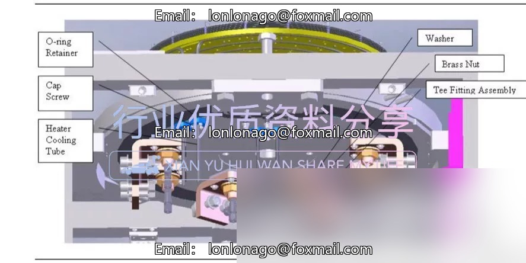
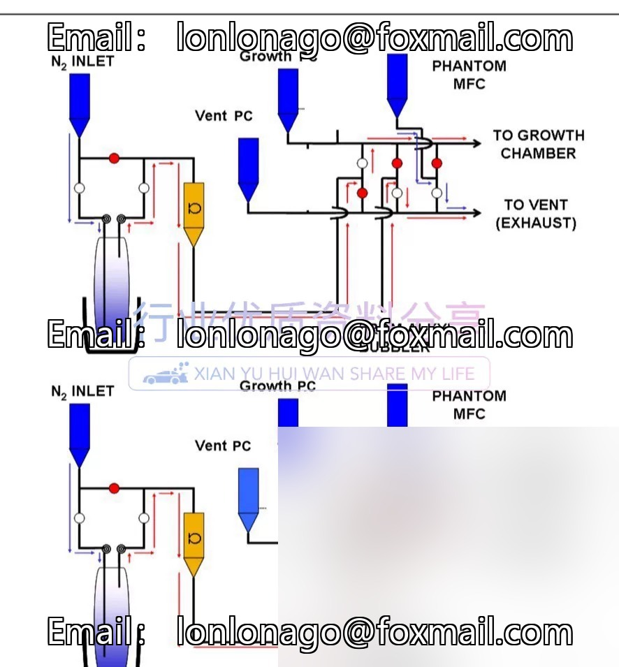
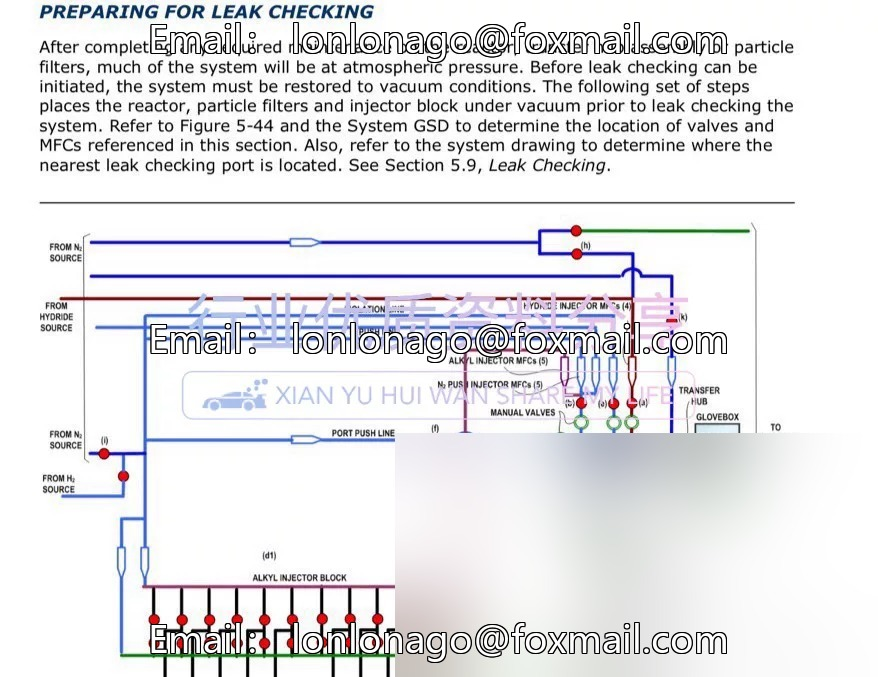
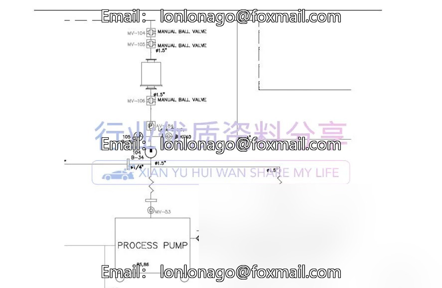
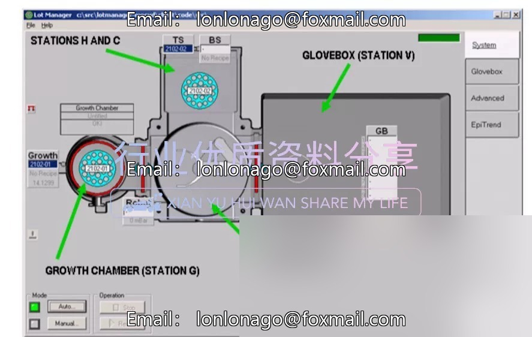
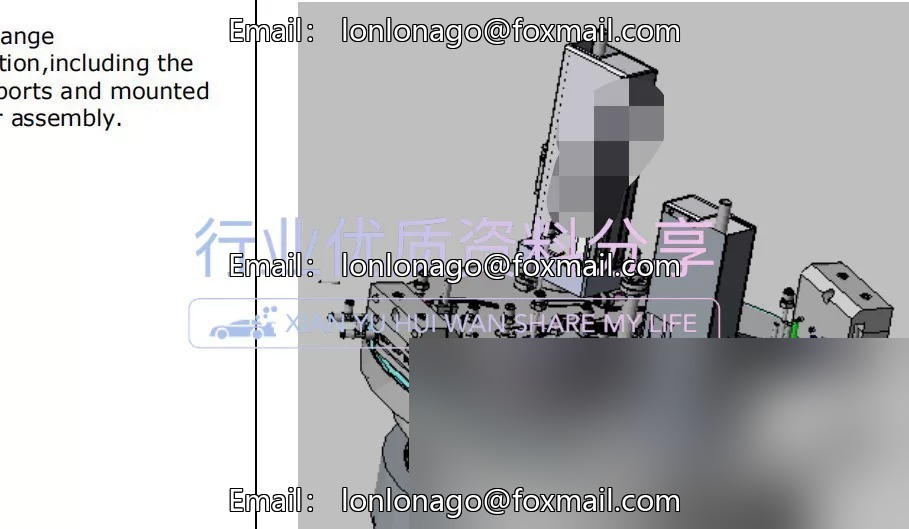
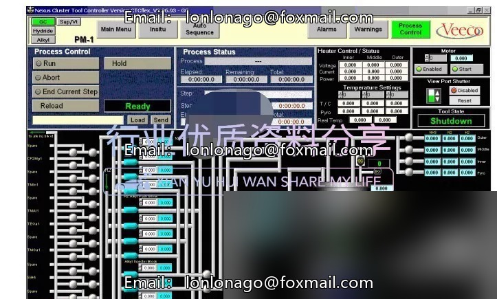

# # pdfVEECO-K465i gallium nitride system, MOCVD deposition equipment

## Body

#pdfVEECO-K465i Gallium Nitride System, MOCVD deposition equipment detailed handbook materials! It includes: control gas and other materials introduction, control of wafer deposition. The wafer rotates horizontally at a controllable speed in the reactor chamber, with controlled reactor pressure and vacuum, cooling system and maintenance.
There is a detailed structure and technical introduction of the heating pallet!!!
352 pages

The materials cover a GAC system and an MOCVD deposition device, including control of gas and material introduction, wafer deposition control, reactor chamber rotation, reactor pressure and vacuum, cooling systems and maintenance, plus detailed structure and technology for a heater with disc.

<!-- AI_ENRICHED -->

## Images

## Payment

Here is a pay link on Stripe ( https://buy.stripe.com/3cs8yP7sY87d0vu9AB ). Please contact me lonlonago@foxmail.com after funding $89, and I will send you a complete data files , thank you!

